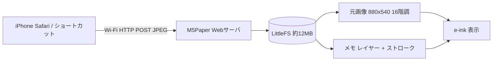

# M5Paper 写真メモ

M5Paper（初代）に写真を表示し、その上にタッチで手書きメモを重ねるアプリ。
メモは「元画像 / メモ1 / メモ2 …」のレイヤー構造で、レイヤーごとに表示・非表示を切り替えられる。



## 画面

| 右側ボタン | 動作 |
|---|---|
| ペン / 消しゴム / 丸ポチ | 順に切り替え。消しゴムは選択中レイヤーの線を 1 本単位で消す。丸ポチは触れた所に黒丸を 1 つ置く（滑っても線にならない） |
| 太さ | 細・中・太を順に切り替え（丸ポチでは大きさ） |
| レイヤー | レイヤーパネルを開く（選択・表示切替・追加・削除） |
| 戻す | 直前の描画 / 消去を取り消す |
| 前へ / 次へ | 写真の切り替え |
| 更新 | 全画面リフレッシュで残像を消す |
| 送る | 写真の送り方（URL と QR コード）を表示 |
| 右下（ページ・電池） | タップで設定パネル（スリープ・電源オフまでの時間） |

メモは描き終えて 3 秒後に自動保存される。

### 拡大表示

| 側面スイッチ | 動作 |
|---|---|
| G39 | 拡大（1 → 1.5 → 2 → 3 → 4 倍） |
| G37 | 縮小（等倍まで） |
| G38 押し込み | 等倍に戻す |

拡大中は画面左端に倍率と ↑←→↓ ボタンが出て、半画面ずつ移動できる。拡大中も書けて、線の太さは画面上で同じに見える（座標は 1/4 px 単位で保存）。

## 省電力

最後の操作から数えて 2 段階で電力を落とす。時間は右下の状態表示（ページ番号・電池残量）をタップして開く「設定」パネルで変更できる。

| 段階 | 既定 | 復帰 |
|---|---|---|
| ライトスリープ | 30 秒 | タッチ / 側面スイッチで即復帰 |
| 電源オフ | 10 分 | 電源ボタン（側面スイッチの押し込み）長押しで起動し、同じ画面から再開 |

- Wi-Fi は「送る」を押した時だけ付き、iPhone からの通信が 60 秒途絶えると切れる
- 電源オフ前にメモ・ツール・太さを Flash に保存する。Undo 履歴は消える
- USB 給電中は電源が落ちずディープスリープになり、側面スイッチの押し込みで起動する

## iPhone から写真を送る

AirDrop は Apple 独自の通信方式なので ESP32 では受けられない。代わりに M5Paper が Wi-Fi 上に Web ページを出す。

1. 「送る」ボタンで表示される QR を iPhone のカメラで読む
   - 初期状態はアクセスポイントモード（SSID `M5Paper-Memo` / パスワード `m5papermemo`）
   - Web ページ下部で家の Wi-Fi を設定すると、以後は `http://m5paper.local/` で開ける
2. 「写真を選ぶ」で写真を選択（複数可）。ブラウザ側で 880x540 に縮小・回転してから送信する

### 共有シートから送る（AirDrop 風）

ショートカット App で以下を作り、「共有シートに表示」をオンにする（受け付ける入力: 画像）。

1. 「画像を変換」… JPEG
2. 「画像のサイズを変更」… 最長辺 1280
3. 「URL の内容を取得」… `http://m5paper.local/api/upload`、方法 POST、本文「フォーム」、フィールド `file`（ファイル）= サイズ変更後の画像

写真 App の共有ボタン →「M5Paper へ送る」で届く。縦長写真はこの方法だと回転されない。

## ビルド

```sh
pio run -t upload
```

- `platform = espressif32@6.10.0`（Arduino 2.0.17）、ボード定義は `m5stack-fire` を流用
- パーティション: アプリ 4MB + LittleFS 約 12MB（初回起動時にフォーマット）

## 保存形式

- `/p/NNNN.g4` … 元画像。6 バイトヘッダ（`G4` + 幅 + 高さ）+ 4bit グレー（Floyd-Steinberg 済み）
- `/p/NNNN.memo` … レイヤー一覧 + ストローク（レイヤー ID・太さ・座標列）
- `/wifi.txt` … SSID とパスワード

## 電池の 0% 電圧の計測（tools/battery_drain）

本体アプリの代わりに書き込む消費加速テスト。Wi-Fi スキャン連続・BLE 送受信・CPU 全開で電池を減らし、電池駆動中は 30 秒ごとに電圧と筐体内温度を `/drain.csv` に記録する。筐体内が 50℃ になると負荷を止め、45℃ で再開する。パーティション表は共通なので写真とメモは残る。起動のたびに前回の記録を `/drain_N.csv`（空いている番号）へ移すので、過去の記録は上書きされない。

2026-10-17 の結果は `tools/battery_drain/data/drain_2026-10-17.csv`。満充電 3.99V から 2 時間 37 分で 3.01V になり停止し、残り 10% (3.52V) から先は 15 分ほどで急に落ちた。本体の残量表示はこの曲線で換算している。

```sh
cd tools/battery_drain && pio run -t upload   # テストを書き込む
# 満充電 → USB を抜いて電源が落ちるまで放置 → USB を挿すと前回の記録の要約が画面とシリアルに出る
cd ../.. && pio run -t upload                 # 本体アプリに戻す
```
